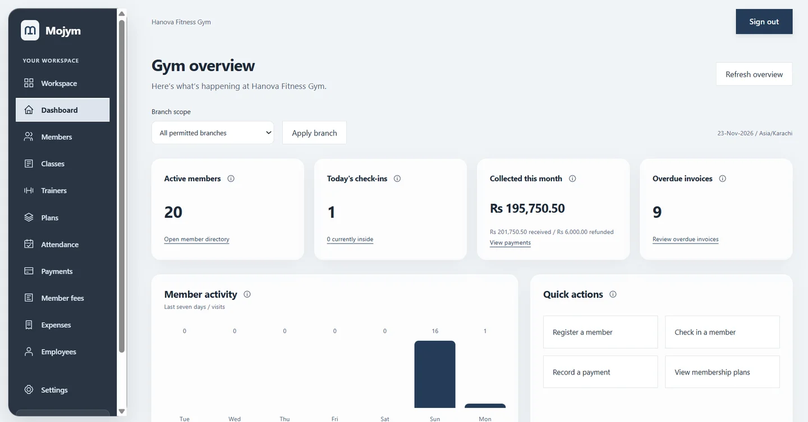
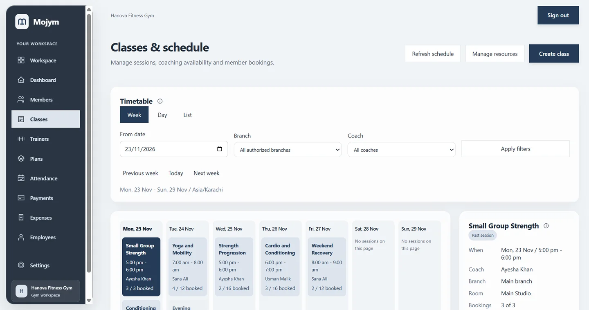
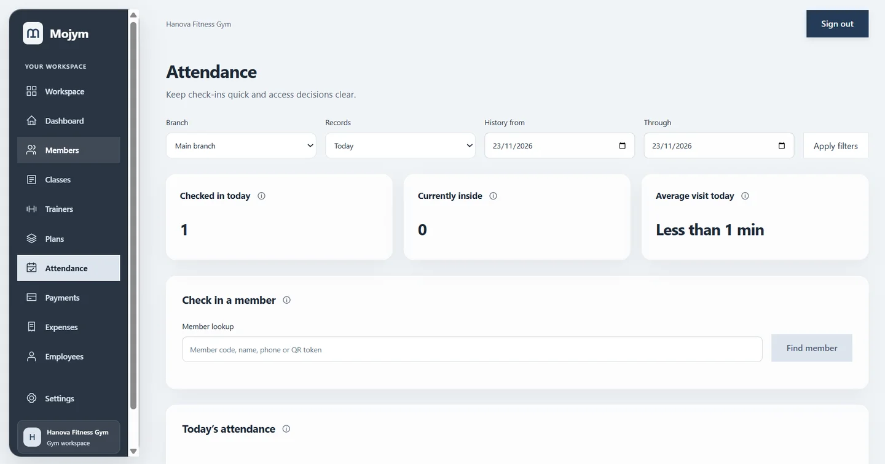

<div align="center">


# Your gym. One clear workspace.

**Members · Memberships · Collections · Coaching · Daily operations**

A thoughtfully designed gym management platform by **Hanova Devs**.
Built for independent gyms, branch teams and the people behind the front desk.

[Explore Mojym](https://mojym.hanovadevs.com/about) · [Usage guide](https://www.hanovadevs.com/products/mojym/how-to-use) · [Request your gym workspace](https://wa.me/19177355385)


</div>

---

## A calmer way to run a busy gym

Mojym brings member records, recurring fees, attendance and coaching into a shared workspace. Reception teams can check people in, owners can follow outstanding balances, and managers can organize their team without juggling disconnected spreadsheets.

The **Silver & Midnight** interface pairs readable glass surfaces with restrained icons and sharp action buttons. Desktop navigation collapses when you need more room; compact mobile screens use bottom navigation and a More menu.

<p align="center"></p>

*Product overview imagery. Operational verification and implementation evidence live in [doc/](doc/00_START_HERE.md).*

## What you can do

| Workspace | Capabilities |
| :--- | :--- |
| **Members & profiles** | Register members, search the directory, maintain contact details and notes, archive records and retain history. |
| **Plans & memberships** | Versioned plans, enrollment, renewal, freeze and cancellation with reviewed dates and pricing. |
| **Member fees** | Agree individual monthly fees, track dated invoices and upcoming renewals, and deliver owner summaries through the configured email workflow. |
| **Invoices & collections** | Draft and issue invoices, allocate partial or full payments, review balances, download invoice and paid-receipt PDFs, and record authorized financial corrections. |
| **Attendance** | Look up members, review eligibility, check in and out, and inspect branch-scoped visit history. |
| **Trainers & classes** | Coaching profiles, trainer assignments, personal training sessions, rooms, availability, timetables and capacity-aware bookings. |
| **Employees & expenses** | Employee profiles, salary rates and payments, operating expenses, reversals and private receipt images. |
| **Enquiries & trials** | Five-stage pipeline, trial dates, staff assignments, dated follow-ups, retained activity and conversion into a member with optional enrollment. |
| **Reports** | Collections, membership and attendance reports with branch/date filters, reconciliation, CSV and print exports. |
| **Platform administration** | Separately authorized gym provisioning, contact details, suspension/reactivation, activity visibility and gym subscription-payment tracking. |

**Payments are records of funds received through the gym’s own payment methods. Mojym does not charge cards or process online payments.** Enquiry follow-up tasks do not automatically send messages.

<details>
<summary><strong>See coaching and attendance</strong></summary>

### Classes & scheduling



### Attendance



</details>

## Designed around real operational safeguards

- **Tenant and branch boundaries:** protected operations revalidate the session, active organization membership, action permission and branch scope.
- **Financial consistency:** integer minor-unit amounts, atomic transactions, retry-safe request keys and retained invoice/receipt snapshots.
- **Reliable workflows:** service/database enforcement for booking capacity, duplicate check-ins and concurrent member conversion.
- **Private by default:** server-only database access, a restricted runtime role, protected attachments and separate migration credentials.
- **Portable PostgreSQL:** app-managed authentication and business IDs remain independent of Supabase Auth. Local PostgreSQL and hosted Supabase PostgreSQL share the application services.

## Built with

| Layer | Technology |
| :--- | :--- |
| Application | Next.js App Router, React, TypeScript |
| Database | PostgreSQL, Drizzle schema and reviewed SQL migrations |
| Authentication | Better Auth with application role/branch authorization |
| Validation | Zod and server-side business rules |
| Documents | Server-rendered PDF invoices and receipts with embedded fonts |
| Verification | Vitest, PostgreSQL integration suites and Playwright |
| Hosting | Vercel application with hosted PostgreSQL support |

## Run locally

Use **Node.js 24**, npm and PostgreSQL. PowerShell examples use `npm.cmd`; other shells can use `npm`.

```powershell
git clone https://github.com/hanovadevs/Gym-CRM.git
cd Gym-CRM
npm.cmd ci
Copy-Item .env.example .env.local
```

Configure `.env.local` using the documented variables. Provision a restricted application role for `DATABASE_URL` and separate migration credentials for `MIGRATION_DATABASE_URL`. Keep test credentials pointed at an isolated `gym_test` database. Never commit environment files or reuse production data for automated tests.

```powershell
# Apply the committed, reviewed migrations.
npm.cmd run db:migrate

# Start the application.
npm.cmd run dev
```

Open the address printed by Next.js. Set `APP_URL` and `BETTER_AUTH_URL` to that exact origin. Production accepts the configured origin; same-port loopback aliases are a local-development convenience.

For a **new, empty installation**, set `OWNER_NAME`, `OWNER_EMAIL`, `GYM_NAME` and `GYM_SLUG`, then bootstrap the first owner:

```powershell
$ownerSecret = Read-Host 'Owner password (12–128 characters)' -AsSecureString
$env:OWNER_PASSWORD = [System.Net.NetworkCredential]::new('', $ownerSecret).Password
try { npm.cmd run auth:bootstrap }
finally { Remove-Item Env:OWNER_PASSWORD }
```

Bootstrap refuses an initialized workspace. Subsequent gyms are created through the separately authorized platform console. Gym login identifiers and real owner recovery addresses are distinct; configure the owner’s reachable email for recovery and notifications.

SMTP settings stay server-side. All gym transactional mail uses the configured shared sender. Automated tests capture mail rather than contacting members. Keep `DEMO_MODE=false` for normal operation; production rejects demo mode.

## Verification

```powershell
npm.cmd run lint
npm.cmd run typecheck
npm.cmd run test:unit
npm.cmd run test:integration
npm.cmd run test:security
npm.cmd run test:payments
npm.cmd run test:reports
npm.cmd run test:enquiries
npm.cmd run build
npm.cmd run test:production

# Install Chromium once before browser testing.
npx.cmd playwright install chromium
npm.cmd run test:e2e
```

Additional module suites are listed in [package.json](package.json). Run PostgreSQL and browser suites **serially** against the isolated test database: some negative tests temporarily alter test grants. A passing unit suite does not establish production readiness; release evidence is tracked separately.

## Project map

```text
src/app/          Pages and server route handlers
src/modules/      Business workflows, validation, services and screens
src/server/       Authentication, authorization and server infrastructure
src/components/   Shared responsive UI
src/db/           Database schema definitions
drizzle/         Committed SQL migrations and snapshots
tests/           Unit, integration and browser verification
public/          Brand assets and product imagery
doc/             Scope, decisions, module status and session evidence
```

## Current delivery status

The core operational modules, reports and enquiry pipeline are implemented. **Bulk CSV import is still in progress:** transport parsing and formula-safe encoding exist; upload/mapping, preview, duplicate policy and repeat-safe commit are not yet a complete user workflow.

Final backup/restore rehearsal, preview/production isolation, complete release regression and retained walkthrough-data reconciliation remain release gates. Do not interpret the live application or this showcase as a claim that every release gate has passed.

| Read next | Purpose |
| :--- | :--- |
| [Start here](doc/00_START_HERE.md) | Product and documentation map |
| [Module tracker](doc/10_MODULE_TRACKER.md) | Current implementation and verification status |
| [Backlog](doc/11_BACKLOG.md) | Remaining work and acceptance evidence |
| [Architecture](doc/03_ARCHITECTURE.md) | Application and database boundaries |
| [Security](doc/07_SECURITY_AND_PERMISSIONS.md) | Permissions and isolation requirements |
| [Decisions](doc/14_DECISIONS.md) | Material design and implementation choices |
| [Session log](doc/15_SESSION_LOG.md) | Reproducible checks and handoff notes |

---

<div align="center">

**Mojym — built by Hanova Devs**

[Website](https://www.hanovadevs.com) · [Discover Mojym](https://mojym.hanovadevs.com/about) · [Talk to us](https://wa.me/19177355385)

</div>
